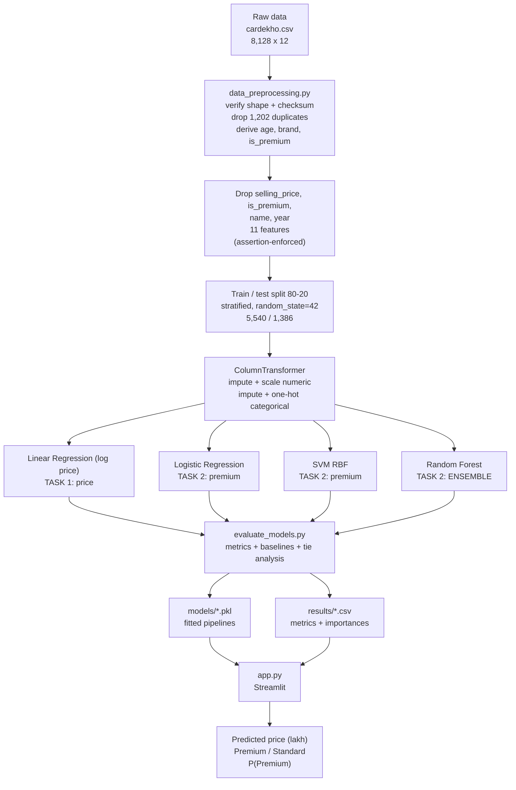
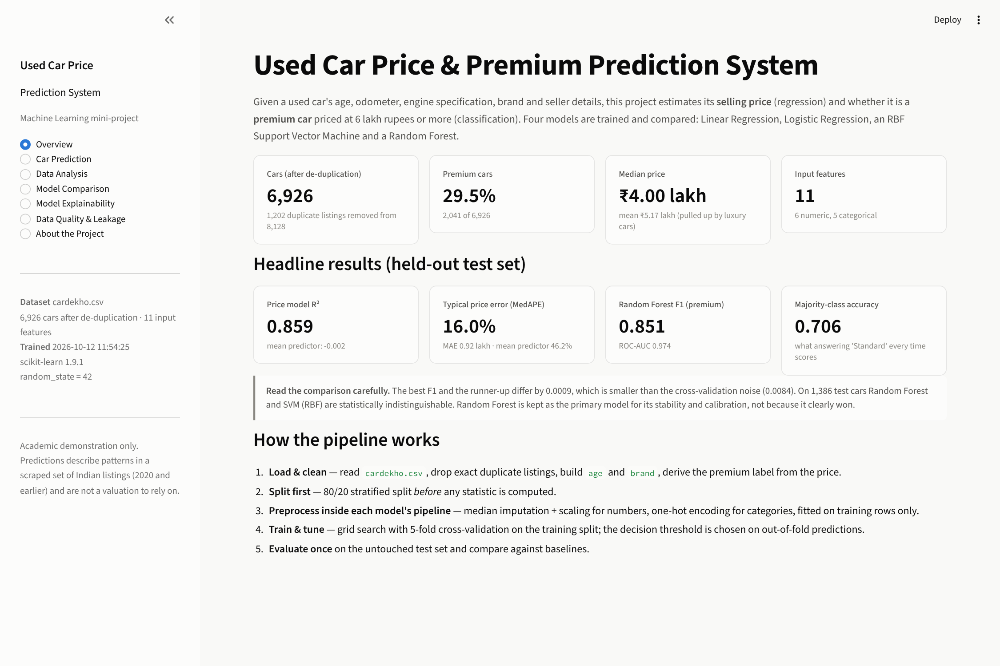
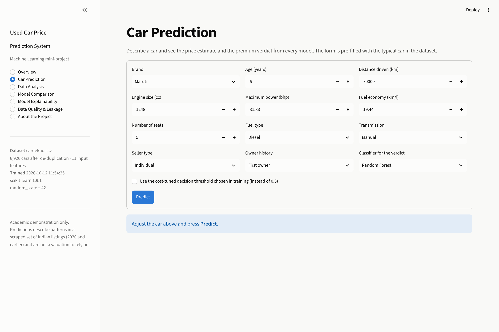
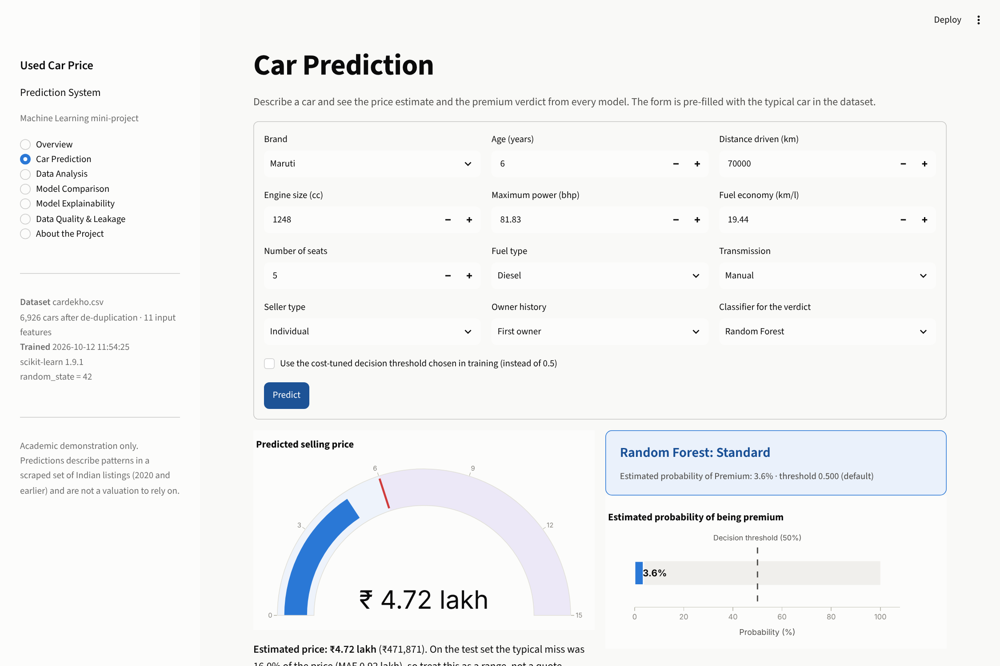
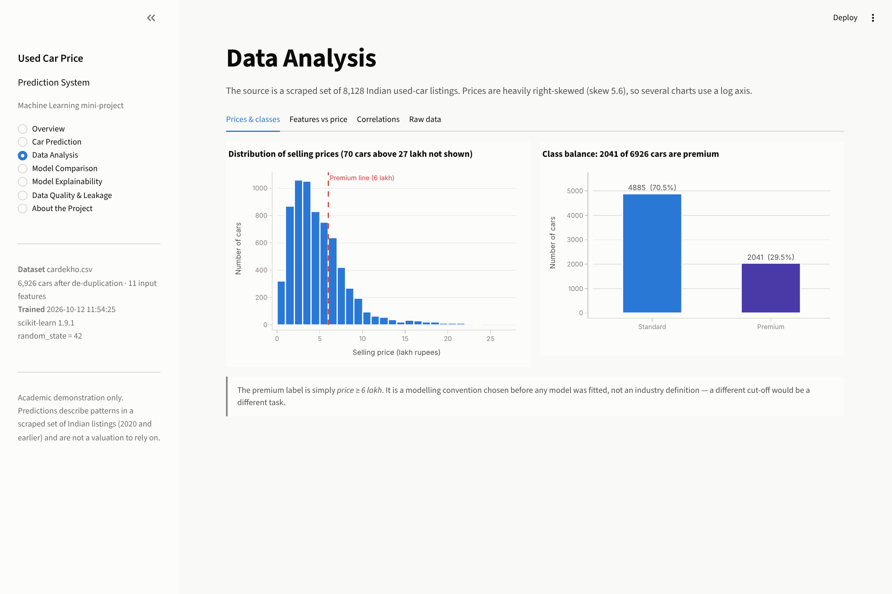
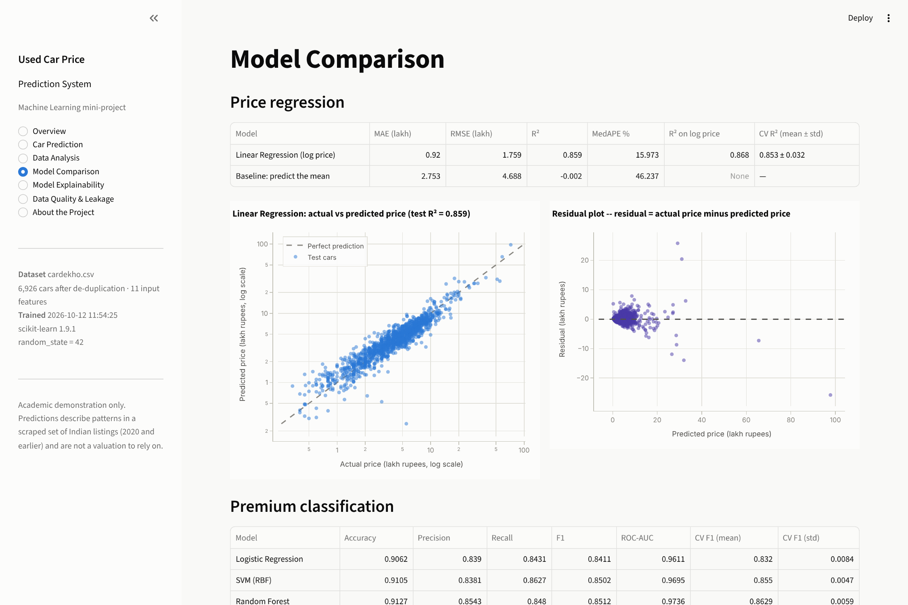
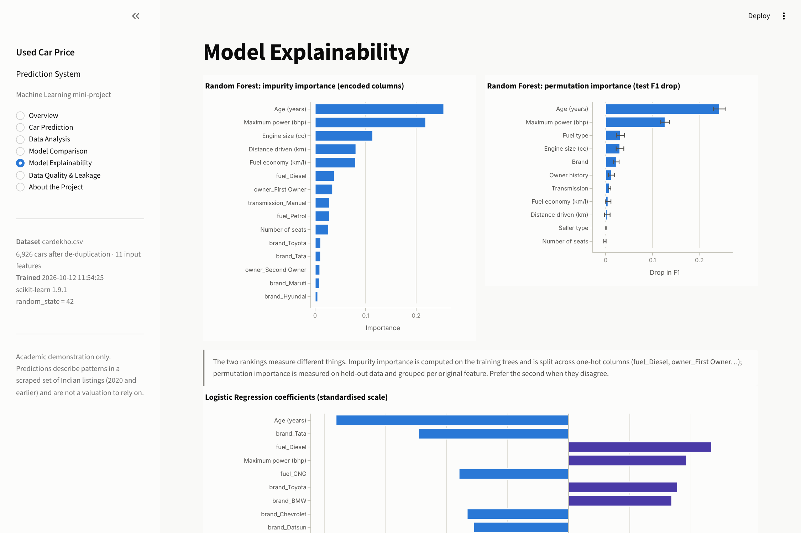
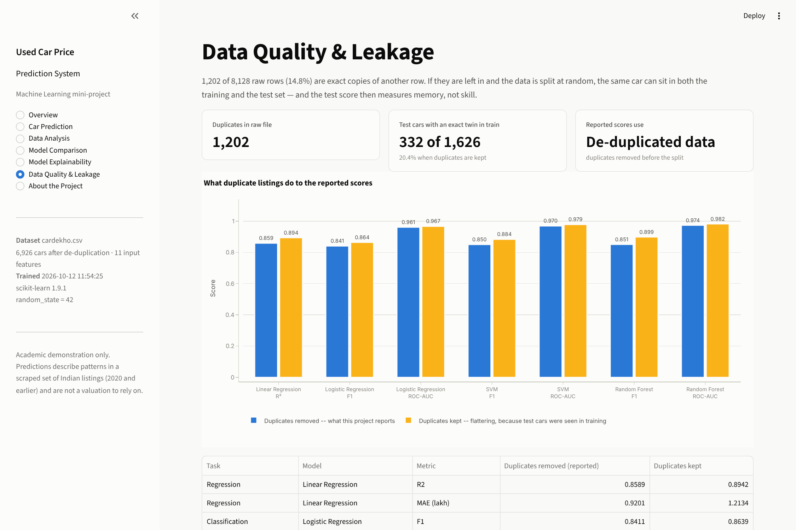

# Used Car Price & Premium Prediction System

A Machine Learning mini-project that predicts the **selling price** of a used car
and classifies it as **Premium** (priced at ₹6 lakh or more) or **Standard**,
using a public set of Indian used-car listings (CarDekho-style, 8,128 rows).
Four algorithms are implemented and compared — Multivariate Linear Regression,
Logistic Regression, a Support Vector Machine and a Random Forest ensemble —
behind an interactive Streamlit application.

> **Every number in this README came out of a trained model.** They are
> reproduced from `results/model_results.csv` and the other files in `results/`,
> which are written by `src/train_models.py`. Nothing is estimated or copied from
> another project. The results are good, but not for free: the largest
> methodological finding is that **15% of the raw file is duplicate listings**,
> and leaving them in would have flattered every model
> ([section 11](#11-the-most-important-result-duplicate-listings)).

---

## Table of contents

1. [Problem statement](#1-problem-statement)
2. [Objectives](#2-objectives)
3. [Dataset](#3-dataset)
4. [Features](#4-features)
5. [Target variables](#5-target-variables)
6. [Data preprocessing](#6-data-preprocessing)
7. [Algorithms used, and why](#7-algorithms-used-and-why)
8. [Ensemble learning explained](#8-ensemble-learning-explained)
9. [Training methodology](#9-training-methodology)
10. [Evaluation metrics](#10-evaluation-metrics)
11. [The most important result: duplicate listings](#11-the-most-important-result-duplicate-listings)
12. [Results](#12-results)
13. [The decision threshold, and whether the probabilities are real](#13-the-decision-threshold-and-whether-the-probabilities-are-real)
14. [Model comparison](#14-model-comparison)
15. [Feature importance](#15-feature-importance)
16. [System architecture](#16-system-architecture)
17. [Screenshots](#17-screenshots)
18. [Installation](#18-installation)
19. [How to run](#19-how-to-run)
20. [Project structure](#20-project-structure)
21. [Limitations](#21-limitations)
22. [Future scope](#22-future-scope)
23. [Ethical statement](#23-ethical-statement)
24. [Conclusion](#24-conclusion)
25. [References](#25-references)

---

## 1. Problem statement

A used car has no list price. Its value depends on how old it is, how far it has
been driven, how powerful it is, who made it and who is selling it — and buyers
and sellers both struggle to judge whether an asking price is fair.

The question this project asks is whether the **asking price can be estimated
from a listing's own attributes**, and whether a listing can be sorted into a
broad price band (Premium or Standard). That framing drives the main design
decisions: no model may see the price (or anything derived from it) as an input,
and the same car may not appear on both sides of the train/test split.

## 2. Objectives

1. Predict the selling price of a used car (**regression**).
2. Classify a car as Premium or Standard (**classification**).
3. Implement the four required algorithms: Multivariate Linear Regression,
   Logistic Regression, Support Vector Machine, and an **ensemble** method
   (Random Forest).
4. Evaluate every model on a held-out test set against explicit baselines, and
   say honestly when two models cannot be told apart.
5. Deliver an interactive web application with a prediction form and charts for
   data analysis, model comparison and explainability.

## 3. Dataset

| | |
|---|---|
| File | `data/raw/cardekho.csv` |
| Rows × columns | 8,128 × 12 |
| SHA-256 | `13680430728ec823242429b5a6826e7e42e38fd379e90d972841d84869e19603` |
| Origin | Copy of the widely circulated CarDekho used-car listings, taken from the public GitHub repository `Sougata-Python-Coder/used-car-price-prediction` |
| Period | Model years up to 2020 |

**Provenance caveat.** This is a scraped dataset redistributed on Kaggle and
GitHub. It has no official specification, no stated collection method and no
confirmed licence, unlike a published repository dataset. It is used here for
coursework only, and the loader refuses to train on a file whose shape differs
(`8128 × 12`) and warns if the checksum differs.

Raw columns: `name, year, selling_price, km_driven, fuel, seller_type,
transmission, owner, mileage(km/ltr/kg), engine, max_power, seats`.

### Four things the data inspection turned up

1. **1,202 rows (14.8%) are exact duplicates.** After removing them, **6,926
   cars** remain. See [section 11](#11-the-most-important-result-duplicate-listings).
2. **Prices are heavily right-skewed** (skew 5.57). Median ₹4.0 lakh, mean
   ₹5.17 lakh, maximum ₹100 lakh. The regression therefore models the
   **logarithm of price**, and charts use log axes.
3. **Missing specifications.** After de-duplication, 208 cars are missing mileage, engine and seats
   *together*, and 206 are missing `max_power` (the column is stored as text and
   one value is a blank space). They are imputed with the median **inside the
   pipeline**, so the imputer only ever sees training rows.
4. **Rare categories.** `owner = Test Drive Car` has 5 cars, `LPG` 38, `CNG` 56
   and `Trustmark Dealer` 27. Any conclusion drawn from these levels is noise.

## 4. Features

Eleven model inputs: six numeric, five categorical.

| Feature | Type | Meaning |
|---|---|---|
| `age` | numeric | 2020 − model year |
| `km_driven` | numeric | odometer, km (3 cars above 500,000; maximum 2,360,457) |
| `mileage` | numeric | fuel economy, km/l (km/kg for CNG, LPG) |
| `engine` | numeric | displacement, cc |
| `max_power` | numeric | maximum power, bhp |
| `seats` | numeric | number of seats |
| `brand` | categorical | first word of `name` (32 brands; rare ones pooled) |
| `fuel` | categorical | Diesel, Petrol, CNG, LPG |
| `seller_type` | categorical | Individual, Dealer, Trustmark Dealer |
| `transmission` | categorical | Manual (6,342 cars), Automatic (584) |
| `owner` | categorical | First, Second, Third, Fourth & above, Test Drive |

Pearson correlation with log price, from the cleaned data: `age` −0.719,
`max_power` +0.654, `engine` +0.474, `seats` +0.267, `km_driven` −0.188,
`mileage` +0.017.

### Excluded columns, and the reason for each

| Column | Why it is not a model input |
|---|---|
| `selling_price` | It **is** the regression target and the source of the premium label. |
| `is_premium` | It is the classification target, derived from the price. |
| `name` | Free text (e.g. "Maruti Swift Dzire VDI"); almost every value is near-unique, so a model could memorise listings. Only its first word, the brand, is kept. |
| `year` | Replaced by `age`; keeping both adds a perfectly collinear column. |

`split_features_target()` asserts that none of these reach the feature matrix, and
`tests/test_leakage.py` proves the assertion fires when one is added.

## 5. Target variables

- **Regression target:** `selling_price` (rupees; reported in lakh, 1 lakh = 100,000).
  The model is trained on `log(price)` and predictions are converted back with
  `exp`, via scikit-learn's `TransformedTargetRegressor`.
- **Classification target:** `is_premium = 1` if `selling_price ≥ 600,000`.
  Class balance after de-duplication: **2,041 Premium (29.47%)** and 4,885
  Standard. A model that always answers "Standard" scores **0.7053 accuracy** —
  the number every accuracy figure below must beat.

**Honest caveat.** ₹6 lakh is a round figure chosen before any model was fitted,
not an industry definition, and the label is a deterministic function of the
regression target. The classification task therefore carries little information
that the regression task does not; it is included because the course requires
all four algorithms, and it has real uses (a banding filter).

## 6. Data preprocessing

1. Strip whitespace from text; **drop exact duplicate rows**.
2. Coerce `max_power` to a number (the blank value becomes missing).
3. Build `age = 2020 − year` and `brand` (first word of `name`, with
   "Land Rover", "Force Motors" and "Ashok Leyland" repaired).
4. Derive `is_premium` from the price.
5. **Stratified 80/20 split** (`random_state=42`): 5,540 training cars, 1,386 test
   cars. Premium share is 29.48% in train and 29.44% in test.
6. Inside each model's `Pipeline` (so it is fitted on training rows only):
   - numeric: median imputation → `StandardScaler`
   - `brand`: most-frequent imputation → `OneHotEncoder` with
     `min_frequency=30` and `handle_unknown="infrequent_if_exist"` — rare and
     never-seen brands share one "infrequent" column
   - other categoricals: most-frequent imputation → `OneHotEncoder`
     (`drop="if_binary"`, `handle_unknown="ignore"`)

   The encoded matrix has 37 columns when fitted on all cars and 36 on the
   training split; the difference comes from the rare-brand pooling, which
   depends on which cars are in the fit.

Scaling matters for Logistic Regression and the SVM (the RBF kernel is a
function of squared distance, so unscaled `km_driven` in the hundreds of
thousands would swamp `seats` at 2–14). Random Forest does not need it but shares
the preprocessor so there is one definition to explain.

## 7. Algorithms used, and why

| Model | Task | Role |
|---|---|---|
| **Multivariate Linear Regression** on log price | Regression | Interpretable baseline; coefficients read as % price change |
| **Logistic Regression** (`C=1`, tuned) | Classification | Linear classifier with interpretable odds ratios |
| **SVM, RBF kernel** (`C=1, gamma=0.1`, tuned) | Classification | Non-linear decision boundary |
| **Random Forest** (400 trees, `max_features=sqrt`, `min_samples_leaf=3`, tuned) | Classification | Bagging **ensemble**; captures interactions |

Hyper-parameters come from `GridSearchCV` with 5-fold stratified CV on the
**training split only**; grids are in `src/train_models.py`.

## 8. Ensemble learning explained

A single decision tree overfits: it can carve the training set into pure leaves
and then generalise badly. **Bagging** (bootstrap aggregating) trains many trees,
each on a bootstrap sample of the training rows, and averages their votes. A
**Random Forest** adds a second source of randomness — each split considers only
a random subset of features (`sqrt` of the total here) — so the trees disagree
with each other for different reasons, and averaging many decorrelated trees
cuts variance without raising bias much.

This project uses 400 trees. `min_samples_leaf=3` stops each tree growing until
it memorises single listings. The forest's training F1 is still **0.9172**
against a test F1 of **0.8512** — a visible generalisation gap, which is normal
for a forest and is why the held-out number, not the training one, is quoted.

## 9. Training methodology

1. Load → clean → split (stratified, seed 42) → **nothing is fitted before the split**.
2. For each classifier: `GridSearchCV` on the training split, scored by F1 on the
   Premium class.
3. `cross_val_score` (5 folds) on the training split for the stability figure
   (mean ± std of F1; for regression, R²).
4. **Out-of-fold probabilities** on the training split choose the decision
   threshold. The test set is never used to choose a threshold.
5. One evaluation on the untouched test set, beside the baselines.
6. Four fitted pipelines and `metadata.pkl` are saved with `joblib`.
7. A **duplicate-leakage demonstration** re-runs the whole procedure on the
   duplicate-laden data, reports the difference, and discards those models.

Total training time on the development machine: about **3¼ minutes** (196 s).

## 10. Evaluation metrics

- **Regression** (in lakh rupees): MAE, MSE, RMSE, R², plus **MedAPE** (median
  absolute % error — the typical miss as a share of price) and R² on log price.
  MAE alone misleads on skewed prices: a 1-lakh error is large on a 2-lakh car
  and trivial on a 40-lakh one.
- **Classification:** accuracy, precision, recall, F1 and ROC-AUC, all for the
  **positive class = Premium**. Accuracy alone is not enough because 70.5% of
  cars are Standard.
- **Baselines:** majority-class classifier; "always predict the training mean"
  regressor.
- **Stability:** CV mean ± std, and a tie analysis (gap vs CV noise).
- **Calibration:** Brier score against a constant base-rate predictor.

## 11. The most important result: duplicate listings

1,202 of 8,128 rows are exact copies of another row. If they are kept and the
data is split at random, the same car lands in both train and test, and the test
score partly measures *memory*. The effect was measured, not assumed, by
retraining every model on the duplicate-laden data:

- With duplicates kept, **332 of 1,626 test cars (20.4%) have an exact twin in
  the training set.**
- Test scores on the same pipeline:

| Model | Metric | Duplicates removed (reported) | Duplicates kept |
|---|---|---|---|
| Linear Regression | R² | 0.8589 | 0.8942 |
| Linear Regression | MAE (lakh) | 0.9201 | 1.2134 |
| Logistic Regression | F1 | 0.8411 | 0.8639 |
| SVM (RBF) | F1 | 0.8502 | 0.8836 |
| Random Forest | F1 | 0.8512 | 0.8988 |
| Random Forest | ROC-AUC | 0.9736 | 0.9821 |
| Random Forest | Accuracy | 0.9127 | 0.9305 |

Every classification score rises when duplicates are kept, and the
flexible models gain most (Random Forest F1 +0.048, SVM +0.033, Logistic
Regression +0.023): models that can memorise benefit from memorisable test rows.
This project reports the left-hand column.

Two honest notes. **First**, Linear Regression's MAE gets *worse* with
duplicates kept (0.92 → 1.21 lakh) while its R² gets better; both are measured on
a different test set (1,626 cars vs 1,386), so they are not a like-for-like
pair, and I have not isolated why they disagree. **Second**, removing duplicates
assumes identical rows are the same listing; two genuinely identical listings
would be wrongly merged. That is plausible for a scraped file but cannot be
verified from the data.

## 12. Results

All figures are on the held-out test set of **1,386 cars** (from
`results/model_results.csv`).

### Regression (price, lakh rupees)

| Model | MAE | RMSE | R² | MedAPE | R² on log price | CV R² (mean ± std) |
|---|---|---|---|---|---|---|
| Linear Regression (log price) | 0.9201 | 1.7593 | 0.8589 | 15.97% | 0.8685 | 0.8527 ± 0.0320 |
| Baseline: predict the mean | 2.7531 | 4.6879 | −0.0020 | 46.24% | — | — |

The model explains about 86% of price variance. The typical prediction is off
by **about 16%** of the price, and RMSE is nearly twice MAE because a few
expensive cars produce large rupee errors. The CV R² varies from 0.825 to 0.909
across folds, so ±0.03 is a realistic uncertainty on that figure.

### Classification (Premium vs Standard)

| Model | Accuracy | Precision | Recall | F1 | ROC-AUC | CV F1 (mean ± std) |
|---|---|---|---|---|---|---|
| Random Forest | 0.9127 | 0.8543 | 0.8480 | 0.8512 | 0.9736 | 0.8629 ± 0.0059 |
| SVM (RBF) | 0.9105 | 0.8381 | 0.8627 | 0.8502 | 0.9695 | 0.8550 ± 0.0047 |
| Logistic Regression | 0.9062 | 0.8390 | 0.8431 | 0.8411 | 0.9611 | 0.8320 ± 0.0084 |
| Baseline (majority class) | 0.7056 | 0.0000 | 0.0000 | 0.0000 | — | — |

### Confusion matrices (test set; positive = Premium)

| Model | TN | FP | FN | TP |
|---|---|---|---|---|
| Random Forest | 919 | 59 | 62 | 346 |
| SVM (RBF) | 910 | 68 | 56 | 352 |
| Logistic Regression | 912 | 66 | 64 | 344 |

### Reading these results honestly

- Every model beats its baseline by a wide margin: +0.20 accuracy over the
  majority class, and R² of 0.86 against −0.002.
- The errors are not random: they cluster around the 6-lakh line. A car priced at
  ₹5.9 lakh and one at ₹6.1 lakh are nearly identical but get opposite labels,
  so some "errors" are unavoidable consequences of the arbitrary threshold.
- The test F1 (0.851) is below the CV F1 (0.863) for the forest by 0.012, about
  two CV standard deviations, so there is mild optimism in the CV figure — hyper-parameters
  were selected on the same folds.

## 13. The decision threshold, and whether the probabilities are real

**Threshold.** The default cut-off of 0.5 is a convention. `train_models.py`
chooses a cut-off on out-of-fold training predictions by minimising expected
errors for a stated false-negative : false-positive cost ratio. Here the ratio is
**1:1**, because nothing about used-car pricing makes one error worse than the
other. The result is a cut-off within a hair of 0.5, and tuning changes nothing
useful:

| Model | Default 0.5: F1 | Cost-tuned threshold | Cost-tuned: F1 |
|---|---|---|---|
| Logistic Regression | 0.8411 | 0.4941 | 0.8415 |
| SVM (RBF) | 0.8502 | 0.4771 | 0.8499 |
| Random Forest | 0.8512 | 0.5007 | 0.8498 |

This is a negative result and is reported as one: a threshold tuned for a symmetric
cost cannot beat 0.5 by more than noise. (The sweep over other ratios, 0.5 to
5, is in `results/` and the app; it is computed on out-of-fold training
predictions, not the test set.) The machinery would matter in a setting with a
real asymmetric cost.

**Calibration.** The three models' Brier scores are 0.0705 (Logistic Regression),
0.0636 (SVM) and **0.0588 (Random Forest)**, against **0.2077** for a constant
predictor that always outputs the base rate. All three beat the constant
predictor by a wide margin, and their mean calibration errors are small (0.013,
0.019, 0.036). Unlike weakly informative models, these probabilities use the whole
0–1 range (minimum ≈0, maximum ≈1), so reading "P(Premium) = 85%" as roughly an
85% chance is defensible *for cars like those in this dataset*. The SVM's
probabilities come from an internal Platt-scaling fit, so near the boundary its
label and its probability can point opposite ways; the app flags this.

## 14. Model comparison

- **Random Forest vs SVM is a statistical tie.** The F1 gap is **0.0009**; the
  cross-validation noise is **0.0084**. On 1,386 test cars these two cannot be
  separated. Random Forest is retained as the primary model for its slightly
  higher ROC-AUC (0.9736 vs 0.9695), better Brier score and lower fold-to-fold
  variance — not because it has been shown to win.
- **Logistic Regression is marginally behind.** Its F1 is 0.0101 below the
  forest, just over the noise floor; its ROC-AUC is 0.0125 lower. It is the
  simplest model and still within about a point of the best, which is the more
  useful finding for a practitioner.
- **The regression model has no competitor** in this project (only Linear
  Regression was required for that task), so its quality is judged against the
  mean predictor, not against another regressor.

## 15. Feature importance

Random Forest, permutation importance on the test set (drop in F1 when a feature
is shuffled):

| Rank | Feature | Drop in F1 |
|---|---|---|
| 1 | `age` | 0.2433 ± 0.0134 |
| 2 | `max_power` | 0.1271 ± 0.0094 |
| 3 | `fuel` | 0.0317 ± 0.0087 |
| 4 | `engine` | 0.0307 ± 0.0082 |
| 5 | `brand` | 0.0230 ± 0.0058 |
| … | `km_driven` | 0.0035 ± 0.0060 |

The **impurity** ranking (training trees) agrees on the top two — `age` 0.255,
`max_power` 0.219 — but ranks `km_driven` (0.081) and `mileage` (0.080) 4th and
5th, while permutation importance puts them near zero (0.0035, 0.0054, within
their standard deviations). Impurity importance is known to favour continuous
features with many split points (Strobl et al., 2007), and the two measures
disagree exactly where that bias would predict. Prefer permutation importance.
Also, `km_driven` and `age` are correlated, so the forest can substitute one for
the other and shuffling either one understates its true value.

**Linear Regression coefficients** (log price, standardised inputs): `age` −0.452
(one standard deviation older ⇒ price × 0.64), `max_power` +0.263, brand effects
such as Mercedes-Benz +0.413 and Tata −0.401. `owner = Test Drive Car` has the
largest coefficient (+0.678) but rests on **5 cars** and should be ignored.
These are associations in listings, not causal effects of changing a car.

## 16. System architecture



`src/train_models.py` is the only thing that fits a model; `app.py` only loads.
If the `.pkl` files are missing the app says so and tells the user to run the
training script — it does not silently retrain.

## 17. Screenshots

| Overview | Car Prediction (form) |
|---|---|
|  |  |

| Prediction result | Data Analysis |
|---|---|
|  |  |

| Model Comparison | Model Explainability |
|---|---|
|  |  |

| Data Quality & Leakage | About |
|---|---|
|  |  |

Static figures for the written report are in `results/figures/`.

## 18. Installation

Requires **Python 3.9 or newer**.

```bash
git clone https://github.com/Athu1/ML_MiniProj.git
cd ML_MiniProj

python -m venv .venv
source .venv/bin/activate        # Windows: .venv\Scripts\activate

pip install -r requirements.txt
```

The dataset is already committed under `data/raw/`, so there is nothing to
download.

## 19. How to run

### Step 1 — train the models

```bash
python src/train_models.py
```

Takes about **3–4 minutes** (196 s on the development machine). It prints a full
training summary and writes the four pipelines to `models/`, the tables to
`results/`, and static figures to `results/figures/`. Flags:

```bash
python src/train_models.py --no-tune               # skip grid searches (faster)
python src/train_models.py --skip-duplicate-demo   # skip the duplicates-kept comparison
python src/train_models.py --no-figures            # skip the static PNG figures
```

### Step 2 — launch the application

```bash
streamlit run app.py
```

Opens at <http://localhost:8501>. Seven sections: Overview, Car Prediction, Data
Analysis, Model Comparison, Model Explainability, Data Quality & Leakage, About
the Project.

### Optional — run the tests

```bash
pip install pytest
pytest
```

81 tests. They guard the project's claims rather than its internals: that the
**leakage assertion fires**, that the scaler's mean comes from the training split,
that the documented data facts hold (1,202 duplicates, 6,926 cars, 2,041 premium),
that committed metrics still match the committed models, that raising the
false-negative cost never raises the decision threshold, and that the prediction
form rejects bad input. The suite was mutation-tested: removing the leakage guard,
keeping the duplicates, or dropping the rare-brand pooling each make it fail.

## 20. Project structure

```
ML_MiniProj/
├── app.py                          Streamlit application (7 sections)
├── requirements.txt
├── README.md
├── data/raw/cardekho.csv           8,128 x 12 listings
├── data/processed/cars_processed.csv   cleaned, de-duplicated table (written by training)
├── models/                         written by train_models.py
│   ├── regression_model.pkl        Linear Regression (log price) pipeline
│   ├── logistic_model.pkl
│   ├── svm_model.pkl
│   ├── random_forest_model.pkl
│   └── metadata.pkl                all metrics, importances, coefficients
├── results/                        CSVs + metrics_summary.json + figures/ (9 PNGs)
├── src/
│   ├── config.py                   paths, seed, threshold, feature lists, exclusions
│   ├── data_preprocessing.py       loading, validation, cleaning, pipeline
│   ├── train_models.py             the full training pipeline (entry point)
│   ├── evaluate_models.py          metrics, baselines, tie analysis, calibration
│   ├── prediction.py               model loading and single-car prediction
│   └── visualization.py            all Plotly figures
├── tests/                          pytest suite (81 tests)
├── notebooks/exploratory_analysis.ipynb
└── docs/                           project_report.md, viva_questions.md,
                                    Mini_Project_Report.docx, screenshots/
```

## 21. Limitations

- **Scraped, unverified data.** No official specification, collection method or
  confirmed licence. Rows are asking prices from listings dated before 2021, not
  transaction prices, and the market has changed since.
- **The classification target is a function of the regression target.** Premium
  is price ≥ 6 lakh, so the two tasks are not independent, and the ₹6 lakh line is
  a convention, not a finding.
- **Random Forest and SVM are statistically tied**; the choice of Random Forest
  is a tie-break, not a victory.
- **Errors scale with price.** Median error is 16% of price, but luxury cars have
  few examples and large rupee errors (RMSE 1.76 lakh vs MAE 0.92 lakh).
- **Rare levels carry no information.** `Test Drive Car` (5 cars), `LPG` (38),
  `CNG` (56) and `Trustmark Dealer` (27) are too small to interpret.
- **Collinear features.** `engine` and `max_power`, and `age` and `km_driven`,
  move together, which makes individual coefficients and importances less stable.
- **Hyper-parameters were chosen on the same folds that give the CV scores**, so
  the CV figures are slightly optimistic; the test figures are the honest ones.
- **Duplicate removal assumes identical rows are the same listing.**
- **No fairness or market-segment analysis** (e.g. regional pricing) was done.

## 22. Future scope

- Fresh, verifiably sourced data with listing dates and location.
- Gradient boosting (e.g. `HistGradientBoostingRegressor`) and a Random Forest
  regressor, to give the price task a real competitor; the log-linear model is a
  deliberately simple baseline.
- Prediction intervals (quantile regression or conformal prediction) instead of a
  point estimate with an average error.
- Per-prediction explanations (SHAP) rather than global importances.
- Using `name` through proper text/model-variant features rather than brand
  alone, with a split that groups by car model to avoid memorisation.
- Replacing the arbitrary ₹6 lakh line with segments defined by an external
  source (hatchback / sedan / SUV).

## 23. Ethical statement

This is an **academic demonstration**, not a valuation tool. A model trained on
asking prices from a scraped sample must not be used to set or judge the price of
a real car, to deny a loan, or to negotiate against a seller who has better
information. Its estimates carry a typical error of about 16%, and that error is
larger for rare and expensive cars. Brand coefficients reflect listing patterns in
one market and time, not the intrinsic worth of a manufacturer.

## 24. Conclusion

- **Price is predictable from a listing's attributes.** A log-linear regression
  reaches test R² 0.859 and a median error of 16%, against R² −0.002 and 46% for
  predicting the average.
- **Premium classification is strong, and three models are close.** F1 is
  0.841–0.851 and ROC-AUC 0.961–0.974 against an accuracy floor of 0.706. Random
  Forest and SVM cannot be separated statistically; Logistic Regression is a
  hair behind.
- **Age and engine power dominate** under both impurity and permutation
  importance; the two measures disagree only on odometer and fuel economy.
- **Tuning the threshold for a symmetric cost did not help**, and the
  probabilities are reasonably calibrated.
- **15% of the raw file is duplicate rows**, and keeping them would have raised
  Random Forest F1 from 0.851 to 0.899 without any real improvement.

The course concepts are all demonstrated: multivariate linear regression,
logistic regression, SVM with a kernel, ensemble learning by bagging,
preprocessing pipelines, stratified splitting, cross-validation, confusion
matrices, regression and classification metrics, feature importance and data
visualisation.

## 25. References

1. L. Breiman. "Random Forests." *Machine Learning*, 45(1):5–32, 2001.
2. L. Breiman. "Bagging Predictors." *Machine Learning*, 24(2):123–140, 1996.
3. C. Cortes and V. Vapnik. "Support-Vector Networks." *Machine Learning*,
   20(3):273–297, 1995.
4. F. Pedregosa et al. "Scikit-learn: Machine Learning in Python." *Journal of
   Machine Learning Research*, 12:2825–2830, 2011.
5. C. Strobl, A.-L. Boulesteix, A. Zeileis and T. Hothorn. "Bias in Random Forest
   Variable Importance Measures: Illustrations, Sources and a Solution." *BMC
   Bioinformatics*, 8:25, 2007.

---

**Disclaimer.** This is a university Machine Learning mini-project built for
academic demonstration and assessment. It is not fit for operational use.
